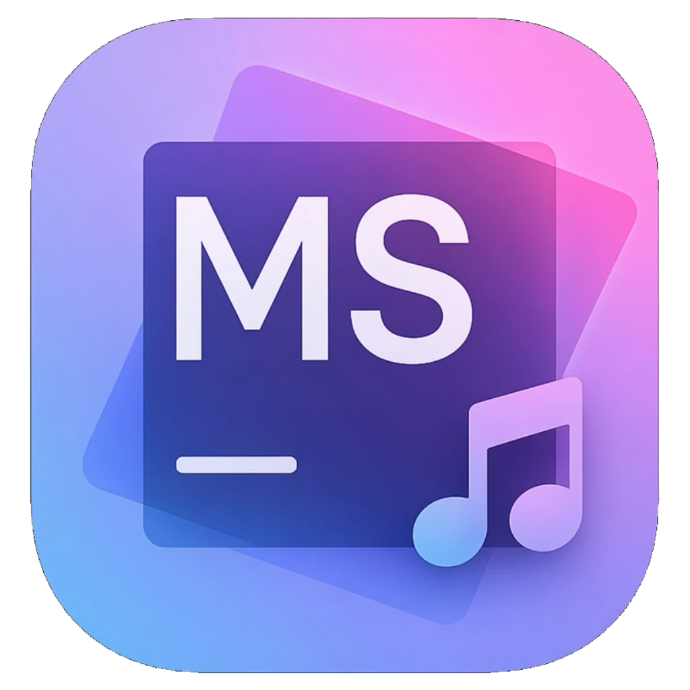

<p align="center">
  
</p>

<h1 align="center">MusicStorm</h1>

<p align="center">让每一次聆听，都成为风暴。</p>

<p align="center">
  <a href="https://github.com/YuiNijika/MusicStorm/releases/latest">下载应用</a>
  ·
  <a href="https://music.miomoe.cn/">网页版</a>
  ·
  <a href="https://github.com/YuiNijika/MusicStorm/issues">反馈问题</a>
</p>

MusicStorm 是一个基于 [Kasumi](https://github.com/YuiNijika/Kasumi) 框架构建的跨平台音乐播放器。它把网易云音乐、B 站音频与本地曲库放进同一个播放界面，提供桌面小播放器、桌面歌词、全屏播放器、播放统计和完整的外观定制能力。

当前主线已经从前代 Tauri 实现迁移到 Kasumi，Windows 与 Android 共用同一套 React 前端和 Kasumi Bridge，不再维护两套独立业务逻辑。

## 核心能力

- **网易云音乐**：歌单、专辑、艺人、电台、MV、评论、云盘、每日推荐与搜索；支持扫码、手机号、邮箱登录和多账号切换。
- **B 站音频**：B 站音频、视频音轨、收藏夹、合集、UP 主与搜索；封面和头像请求自动处理 Referer，避免防盗链导致的 403。
- **本地音乐**：导入文件夹后自动读取元数据与封面，按歌曲、专辑、艺人分组；支持 MP3、FLAC、WAV、AAC、M4A、OGG、APE、DSF、DFF、Opus 等常见格式。
- **播放体验**：播放队列、随机与循环、倍速、音量、进度、淡入淡出、10 段均衡器、单曲 EQ 覆盖、全屏播放器与同步歌词。
- **桌面集成**：无边框标题栏、系统托盘、关闭到托盘、全局快捷键、迷你播放器、桌面歌词、系统媒体控制与“正在播放”信息。
- **移动端适配**：Android 返回手势、系统媒体会话、后台播放控制、响应式侧栏与移动导航。
- **外观定制**：亮色、暗色与跟随系统；多套主题、强调色、毛玻璃、背景图、字体、侧栏风格、路由过渡和性能模式。
- **数据与更新**：播放时长与会话统计、封面缓存、本地歌词覆盖、GitHub Release 检查更新与安装包下载。

## 平台支持

| 平台 | 状态 | 说明 |
| --- | --- | --- |
| Windows 10/11 | 支持 | 基于 WebView2，使用 Kasumi 原生窗口与系统集成 |
| Android 7.0+ | 支持 | minSdk 24，使用 Kasumi Android 宿主与系统媒体会话 |
| 浏览器 | 预览 | 支持在线播放与浏览器本地导入，功能少于桌面端 |

Windows 需要 Microsoft Edge WebView2 Runtime。Windows 10/11 通常已自带；缺失时应用会显示初始化失败面板和日志路径。

## 技术栈

- **前端**：React 19、TypeScript、Vite 8、Tailwind CSS 4、shadcn/ui、Base UI、Radix 兼容组件。
- **运行时**：Kasumi Bridge、Kasumi CLI、Windows WebView2 宿主、Android WebView 宿主。
- **播放**：HTML5 Audio、ArtPlayer、HLS.js、Android MediaPlayer、可选原生音频后端。
- **数据与可视化**：SQLite、IndexedDB、localStorage、Recharts、music-metadata。

## 项目结构

```text
ksm_new/
├─ frontend/                 React 前端与四个 HTML 入口
│  ├─ src/components/        应用壳、播放器、曲库、设置与 shadcn/ui 组件
│  ├─ src/hooks/             播放、导航、登录、窗口、媒体会话等状态层
│  ├─ src/lib/               网易云、B 站、本地曲库、播放引擎与工具
│  └─ src/pages/             首页、搜索、曲库、统计、设置等页面
├─ windows/                  Kasumi Windows 宿主与原生插件
├─ android/                  Kasumi Android 宿主
├─ extensions/               MusicStorm 自定义命令与事件声明
├─ icons/                    窗口、托盘、安装包与 Android 图标
├─ kasumi.config.json        Kasumi 应用配置
└─ package.json              开发、构建与打包脚本
```

## 开发

### 环境要求

- Node.js `^20.19.0` 或 `>=22.12.0`
- pnpm
- Windows：Visual Studio 2022 C++ 桌面开发、CMake 3.25+、vcpkg、WebView2 Runtime
- Android：JDK 21、Android SDK 36、Android Studio 或命令行 SDK 工具

### 安装与运行

```bash
pnpm install

# 启动前端与当前平台开发宿主
pnpm dev

# 只启动指定平台
pnpm dev:windows
pnpm dev:android

# 只启动 Vite 前端
pnpm frontend:dev
```

Windows 开发模式会监听 `kasumi.config.json`、`windows/` 和 `extensions/`。保存后端源码或配置后，Kasumi CLI 会自动重建并重启宿主；前端由 Vite 热更新。

### 构建与打包

```bash
pnpm typecheck
pnpm build:windows
pnpm build:android
pnpm build:all

# 生成发布产物
pnpm package
```

Kasumi 的开发、构建与发布产物位于 `.ksm/` 下，不要手动修改或提交该目录。

Android release 构建需要配置以下环境变量：

```bash
KASUMI_ANDROID_KEYSTORE
KASUMI_ANDROID_KEYSTORE_PASSWORD
KASUMI_ANDROID_KEY_ALIAS
KASUMI_ANDROID_KEY_PASSWORD
```

## Kasumi 配置

应用配置位于 `kasumi.config.json`，字段定义以 Kasumi 的 `protocol/kasumi.config.schema.json` 为准。

### 命令与权限

当前 Windows 与 Android 都使用：

```json
{
  "commands": "all",
  "permissions": "all"
}
```

如果改为显式数组，必须包含 `ping` 与 `capabilities.query`，并且只能列出对应平台支持的协议命令。宿主会区分“配置禁用”和“平台不支持”，便于定位 `NOT_SUPPORTED`。

### 窗口、图标与错误页

Windows 关闭了原生标题栏，窗口尺寸、最小/最大边界和 WebView2 背景色由配置驱动：

```json
{
  "windows": {
    "decorations": false,
    "window": {
      "width": 1280,
      "height": 800,
      "minWidth": 960,
      "minHeight": 600,
      "backgroundColor": "#0B0B0D"
    }
  }
}
```

图标统一写在根级 `icons`：

```json
{
  "icons": {
    "window": "icons/icon.ico",
    "tray": "icons/icon.ico",
    "installer": "icons/icon.ico",
    "android": "icons/android.png"
  }
}
```

`window`、`tray`、`installer` 必须是 `.ico`；`android` 必须是方形 `.png`。路径越界、扩展名不匹配或文件缺失时构建会直接失败。

Windows 还可以通过 `windows.errorPage` 自定义 WebView2 初始化或导航失败面板的颜色、标题和提示。未配置时会根据窗口背景自动选择浅色或深色配色。

### Android WebView 入口

Android 的四个 HTML 入口同时登记在生产入口、开发入口和 HTML 白名单中：

```json
{
  "android": {
    "webview": {
      "productionEntry": "https://app.local/index.html",
      "developmentEntries": [
        "http://localhost:5173/index.html",
        "http://localhost:5173/mini-player.html",
        "http://localhost:5173/desktop-lyric.html",
        "http://localhost:5173/player.html"
      ],
      "supportedHtmlFiles": [
        "index.html",
        "mini-player.html",
        "desktop-lyric.html",
        "player.html"
      ]
    }
  }
}
```

开发入口必须与 Vite 实际地址精确匹配。生产入口和开发入口使用的 HTML 文件都必须出现在 `supportedHtmlFiles` 中。

### 网络白名单

`windows.http.allowedOrigins` 与 `android.http.allowedOrigins` 使用精确 HTTPS origin。当前配置覆盖网易云 API 与图片 CDN、B 站 API、B 站图片 CDN、GitHub API、更新镜像和二维码服务。新增接口域名时，需要同时更新 Windows 与 Android 的白名单。

## 多入口

| 入口 | 用途 |
| --- | --- |
| `index.html` | 主窗口、完整曲库与设置 |
| `player.html` | 独立播放器页面 |
| `mini-player.html` | 桌面迷你播放器 |
| `desktop-lyric.html` | 桌面歌词窗口 |

四个入口共用同一套组件与状态层，但拥有独立的窗口尺寸和生命周期。桌面端通过 Kasumi 多窗口 API 创建、显示和同步这些窗口。

## 快捷键

以下为默认应用内快捷键，可在“设置 → 快捷键”中修改：

| 动作 | 默认按键 |
| --- | --- |
| 播放 / 暂停 | `Space` |
| 快退 / 快进 5 秒 | `←` / `→` |
| 音量减 / 加 | `↓` / `↑` |
| 上一首 / 下一首 | `[` / `]` |
| 关闭全屏播放器 | `Esc` |
| 歌词放大 / 缩小 | `Alt+↑` / `Alt+↓` |

系统级全局快捷键与播放器内快捷键分开配置，修改后立即生效。

## 数据与缓存

- 账号凭据、主题、播放偏好和快捷键保存在本机。
- 本地曲库与播放统计使用 SQLite；网页版使用浏览器 IndexedDB。
- 封面缓存按设置的上限回收，被歌单、本地曲库或手动覆盖引用的封面不会被清理。
- 清除缓存后，本地封面会从音频文件重新解析，远程封面会按需重新下载。

## 常见问题

### Android 提示无法连接宿主或 `NOT_SUPPORTED`

先确认使用 `pnpm dev:android` 或 `pnpm build:android` 生成宿主，而不是直接安装旧版 APK。检查 `kasumi.config.json` 中 `android.commands` 是否包含页面实际调用的命令；使用 `"all"` 时会按平台矩阵展开。Kasumi 26.11.12 起，平台不支持的协议命令不会再被误报为“配置禁用”。

### Windows 显示 WebView2 初始化失败

安装 Microsoft Edge WebView2 Runtime 后重试。失败面板会显示错误原因、目标 URL 和日志路径；日志默认位于 `%LOCALAPPDATA%\Kasumi\Logs\`。

### B 站图片返回 403

确认 `http.allowedOrigins` 包含 `i0.hdslb.com` 至 `i4.hdslb.com`、`archive.biliimg.com` 与 `i0.biliimg.com` 至 `i3.biliimg.com`。应用会为 B 站图片附加 Referer；修改白名单后需要重新构建宿主。

### 本地音乐没有封面或元数据

确认音频文件包含可读的 ID3、Vorbis Comment 或对应容器元数据。无法解析时可以在曲库中手动设置封面；清除缓存后应用会尝试从音频文件重新提取。

### 网页版与桌面版功能差异

网页版受浏览器安全模型限制，无法使用系统托盘、全局快捷键、原生音频输出、桌面歌词窗口和部分本地文件能力。需要完整功能时请使用 Windows 或 Android 客户端。

## 许可证

MusicStorm 使用 MIT License，版权归 YuiNijika 所有。

本项目与网易云音乐、哔哩哔哩及其关联公司无隶属、授权或合作关系。在线内容的版权归对应权利人所有，请遵守当地法律与平台服务条款，不要将本项目用于绕过付费、版权保护或其他访问限制。
